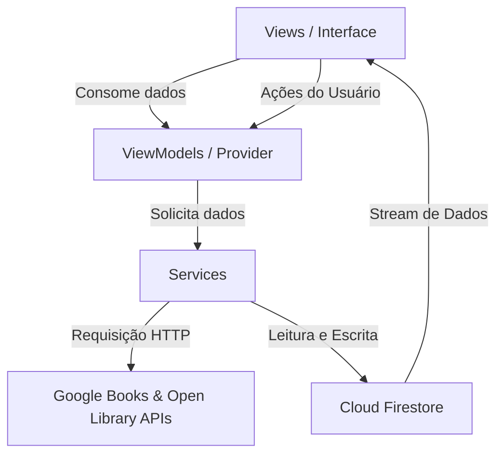

```markdown
# 📚 Emy's Versos - Estante de Livros Digital

**Emy's Versos** é um aplicativo móvel Android desenvolvido em Flutter para gestão e acompanhamento de leituras pessoais. O aplicativo permite buscar livros em APIs públicas, cadastrar novos livros manualmente, organizá-los em estantes virtuais (*Quero Ler*, *Lendo*, *Lidos*), acompanhar o progresso de leitura em tempo real e visualizar estatísticas gerais.

---

## 🎨 Tema e Identidade Visual

O aplicativo utiliza uma paleta elegante em tons de **Roxo e Lilás** (`#6A1B9A`, `#8E24AA`, `#E1BEE7`), garantindo uma interface moderna, acolhedora e agradável para os leitores.

---

## 🛠️ Tecnologias e Dependências

- **Linguagem / Framework:** Dart e [Flutter](https://flutter.dev)
- **Gerenciamento de Estado:** [Provider](https://pub.dev/packages/provider)
- **Autenticação & Backend:** 
  - [Firebase Auth](https://firebase.google.com/docs/auth) (E-mail/Senha e Google Sign-In)
  - [Cloud Firestore](https://firebase.google.com/docs/firestore) (Persistência de dados em tempo real)
- **APIs de Livros:**
  - [Google Books API](https://developers.google.com/books)
  - [Open Library API](https://openlibrary.org/developers/api)
- **Outros Pacientes:** `http`, `google_fonts`, `google_sign_in`, `url_launcher`

---

## 🏗️ Arquitetura do Projeto

O projeto segue o padrão **MVVM (Model-View-ViewModel)** com separação bem definida de responsabilidades:



### 📁 Estrutura de Pastas

```text
lib/
├── models/
│   └── book_model.dart          # Modelo de dados do livro
├── services/
│   ├── auth_service.dart        # Gerenciamento de Autenticação (Firebase e Google)
│   ├── database_service.dart    # Operações de leitura/escrita no Firestore
│   └── google_books_service.dart# Integração com APIs externas
├── viewmodels/
│   └── book_provider.dart       # Estado global e regras de negócio dos livros
└── views/
    ├── login_view.dart          # Tela de Login e Registro
    ├── main_navigation_view.dart# Navegação por abas (BottomNavigationBar)
    ├── search_books_view.dart   # Tela de busca de livros
    ├── shelves_view.dart        # Tela de estantes com abas (Quero Ler, Lendo, Lidos)
    └── stats_view.dart          # Painel estatístico em tempo real

```

---

## 🌟 Funcionalidades

* **🔒 Autenticação Flexível:** Registro e login via E-mail/Senha ou Google Sign-In.
* **🔍 Busca Integrada:** Consulta simultânea à Google Books API e Open Library API.
* **➕ Cadastro Manual:** Formulário para adicionar livros personalizados informando Título, Autor, Páginas, Descrição e URL da Capa.
* **📚 Estantes Virtuais:**
* **Quero Ler:** Lista de desejos de leitura.
* **Lendo:** Livros em andamento com barra de progresso visual.
* **Lidos:** Histórico de livros concluídos.


* **✏️ Gestão e Progresso:**
* Atualização diária das páginas lidas.
* Edição do número total de páginas do livro.
* Movimentação fácil de livros entre as estantes.
* Remoção de livros com confirmação de segurança.


* **📊 Estatísticas em Tempo Real:** Cálculo automático do total de livros lidos e páginas lidas gravado e atualizado no Firestore.
* **📖 Leitor de Prévia:** Botão **"LER"** para redirecionar o usuário diretamente para a prévia externa do livro.

---

## 🗄️ Estrutura do Banco de Dados (Cloud Firestore)

Os dados são mantidos estruturados e isolados por usuário:

```text
/users/{userId}
  ├── /books/{bookId}
  │     ├── id: String
  │     ├── title: String
  │     ├── authors: Array<String>
  │     ├── description: String
  │     ├── pageCount: Number
  │     ├── pagesRead: Number
  │     ├── status: String ("Quero Ler" | "Lendo" | "Lidos")
  │     ├── thumbnailUrl: String?
  │     └── previewLink: String?
  │
  └── /stats/general
        ├── livrosLidos: Number
        └── paginasLidas: Number

```

---

## 🚀 Como Executar o Projeto

### Pré-requisitos

* [Flutter SDK](https://docs.flutter.dev/get-started/install) instalado.
* Android Studio / VS Code configurados.
* Projeto configurado no [Firebase Console](https://console.firebase.google.com/).

### Passo a passo

1. **Clonar o repositório:**
```bash
git clone [https://github.com/seu-usuario/emys_versos.git](https://github.com/seu-usuario/emys_versos.git)
cd emys_versos

```


2. **Instalar as dependências:**
```bash
flutter pub get

```


3. **Configurar o Firebase:**
Certifique-se de que o arquivo `google-services.json` está dentro da pasta `android/app/` e que a chave **SHA-1** do seu ambiente local está registrada no Console do Firebase para o Google Sign-In funcionar.
4. **Executar a aplicação:**
```bash
flutter run

```
